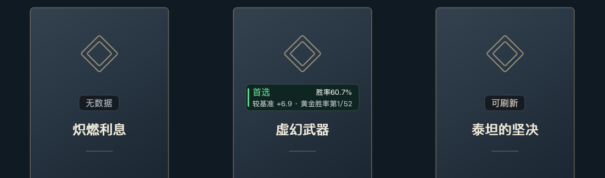
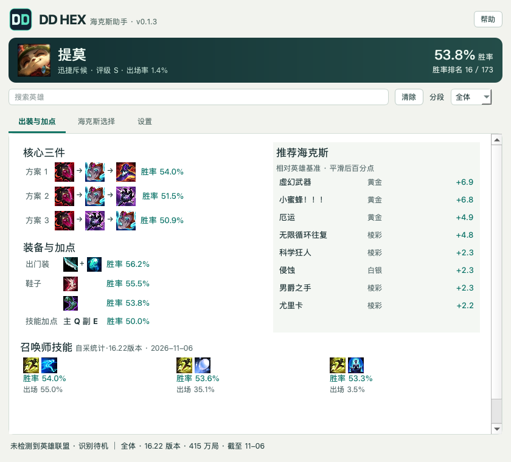
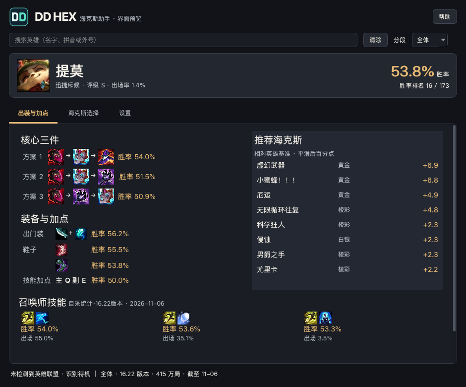

# DD HEX 海克斯助手 0.1.4

基于 [czgreat/aramhex](https://github.com/czgreat/aramhex) 的独立 Windows 衍生版本。暂定品牌为 **DD HEX**，不是原作者发行版，也不暗示原作者为本版本背书。

第一版保留截图 OCR、选英雄胜率、三/四选一推荐、出装与加点、游戏浮窗和托盘。只截屏识别，不读取游戏内存、不注入、不接 LCU 或游戏 2999 接口、不模拟输入。

## 第一版改动

- 独立版本 `0.1.4`、DD 图标、`DD HEX.exe`、安装 AppId、单实例、自启项和 `%APPDATA%\DD HEX` 数据目录，便携版仍使用程序旁 `userdata`。
- 设置里可调：胜率数字显示、平滑强度（默认 300 局）、首选样本门槛（默认 1000 局）。修改立即生效并保存；原始胜率、场次和数据口径保留。数据不足时明确标注。
- 默认使用内置快照；统计更新需要主动勾选，之后仅从公开 `czgreat/aramhex-data` GitHub 数据仓库获取并校验 SHA-256。数据是部分对局样本，不代表全服，不保证预测结果。
- 忽略原版云控缓存，禁用匿名编号、日志上传、远程调试及账号查分。软件更新源默认留空，保留独立仓库更新、增量替换与回滚实现，拒绝原作者程序/数据仓库作为软件更新源。
- 增加离线推荐演示，保留截图文件 OCR 排查入口和 Windows GUI/OCR 打包自检。原版发布工作流改为手动构建，仅保留构建产物。

## Windows 今晚试用

下载 [DD-HEX-0.1.4-Windows-x64.zip](https://github.com/ohoho395/DD-HEX/releases/tag/v0.1.4)，完整解压到可写目录，双击 DD HEX.exe。运行时和 OCR 模型已经随包提供。随包数据详见 [数据来源](docs/DATA-SOURCES.md)。

## Windows 源码运行

Windows 10/11 **64 位**，Python **3.13 64 位**。在本目录打开 PowerShell：

```powershell
py -3.13 -m venv .venv
.\.venv\Scripts\python.exe -m pip install -r requirements.txt
.\.venv\Scripts\python.exe -m lolhex --demo --hero 提莫
.\.venv\Scripts\python.exe -m lolhex
```

游戏使用**无边框或窗口化**。打开助手后可先搜索英雄检查内置数据；游戏前台会自动识别，未认出英雄时可手动搜索选择。关主窗口会留在托盘，从托盘退出才停止识别。默认不绑定快捷键，可在设置中添加或清空。

完整安装、首次使用、截图测试、EXE 打包和排查见 [Windows 使用与打包说明](docs/WINDOWS.md)。代码检查、实现范围与验证结果见 [开发说明](docs/DEVELOPMENT.md)、[第一版实施记录](docs/FORK-IMPLEMENTATION.md)、[验证报告](docs/VERIFICATION.md)。

## 权利与来源

- 程序代码沿用 [MIT LICENSE](LICENSE)，原有 `Copyright (c) 2026 czgreat` 完整保留。
- `lolhex/data/bundled/` 统计来自 [czgreat/aramhex-data](https://github.com/czgreat/aramhex-data)，遵守 [CC BY-NC 4.0](DATA-LICENSE-CC-BY-NC-4.0.txt)，**署名、附许可证、注明修改，仅限非商业使用**。本版本原样保留内置统计文件，只改变本地推荐参数和展示。不得把这些数据用于收费版本、商业服务或变相商业用途；要商业化必须另获授权或替换为可商业使用的数据及相关派生内容。
- 第三方组件和腾讯/Riot 资料、图标权利见 [NOTICE.md](NOTICE.md) 和 [THIRD_PARTY_LICENSES](THIRD_PARTY_LICENSES/README.md)。MIT 不会把统计或游戏素材变成可自由商业使用的资产。
- 非官方工具，与腾讯、Riot Games 无关。截图识别的技术方式不构成游戏规则许可或封禁风险保证。

本次基于上游提交 `5b5d37da1c555c29d8a91499b13fc4f56ca6db14`（上游版本 1.1.9）。原文档备份：[README](docs/UPSTREAM-README.md)、[开发说明](docs/UPSTREAM-DEVELOPMENT.md)；其原版服务和下载地址不适用于 DD HEX。

在「设置 → 本地存储 → 清理截图」可删除助手保存的选卡和调试截图。确认后显示删除数量。清理后仍按原规则保存新截图。

0.1.2 的选卡标签按文字宽度显示。绿色短线标记首选，其他选项使用中性色；缺少实测胜率时保留文字提示。



0.1.3 更新桌面英雄、海克斯和设置三页。英雄页将出装与海克斯排行并排显示；设置页按用途分组。



## 0.1.4 深色试用版

- 没有统计或只有官方评级时，卡片显示无数据。整组都缺少可靠依据时显示“暂无可靠推荐”，换牌序不会改变结论。
- 英雄榜按设置中的首选样本门槛展示，并单列小样本参考，标出场次与口径。
- 统计检查区分对局中推迟、检查进行中、已核对与连接失败。设置里可以看到数据版本、样本日期及上次成功检查时间。
- 客户端离开前台或观察线程退出后，释放选英雄截图缓冲。


